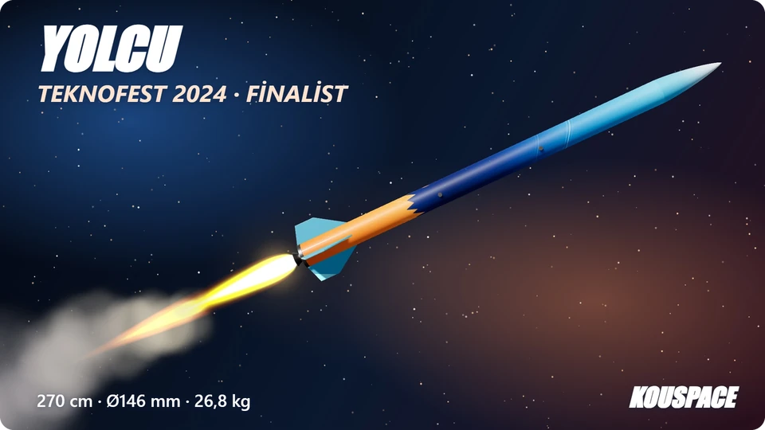
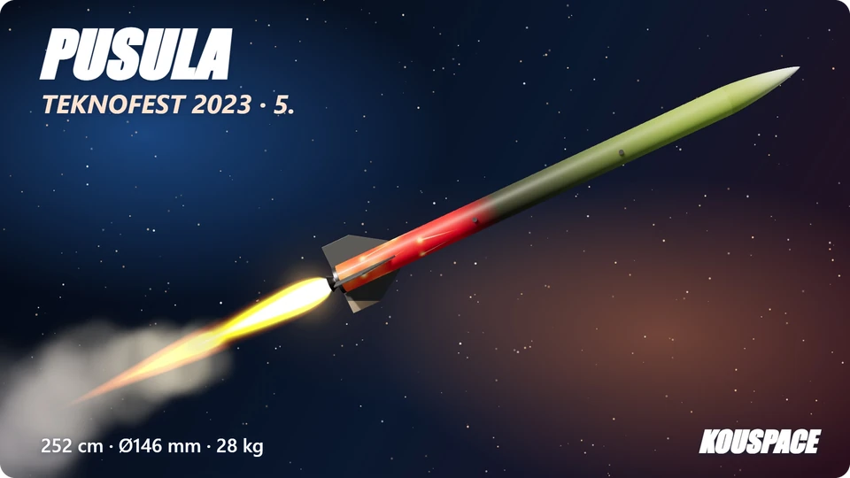
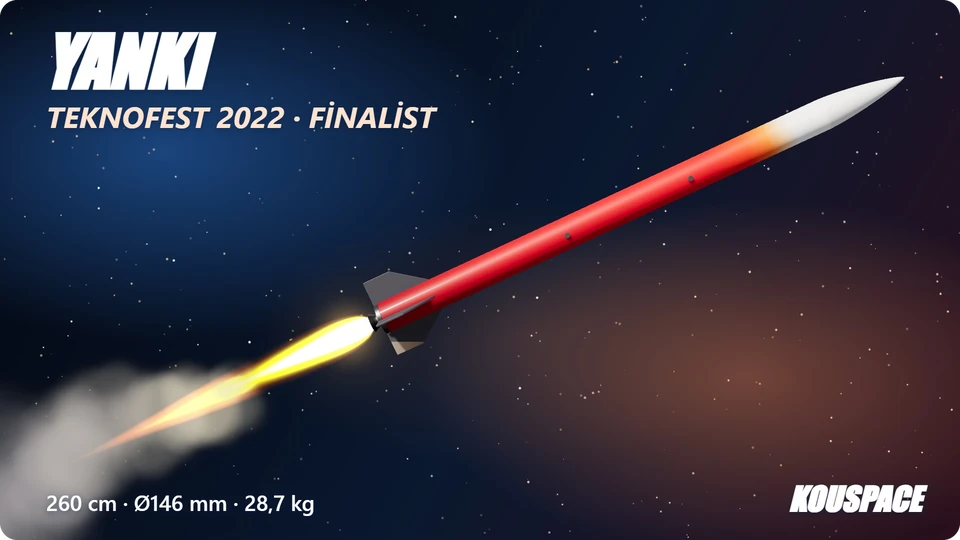
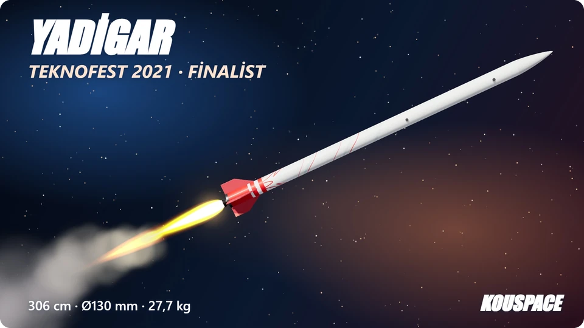
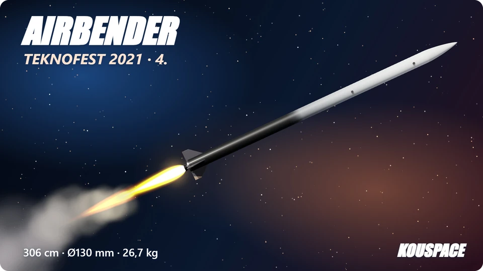
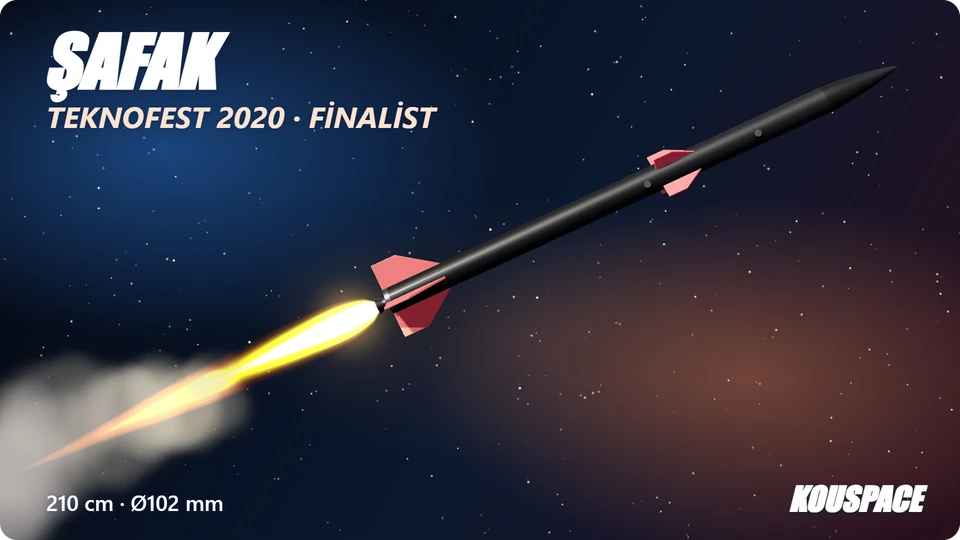

    

---

### 👨‍🚀 Biz Kimiz?

**KOUSpace**, 2019 yılında farklı mühendislik disiplinlerinden uzay ve havacılık tutkunlarının bir araya gelmesiyle kurulan bir öğrenci roket takımıdır.

Amacımız Türkiye'de ve dünyada uzay ve havacılık çalışmalarına katkı sağlamak, bu alanlarda yeni teknolojiler geliştirmek. Özgün roket sistemleri ve alt takımlar tasarlıyor, Türkiye'deki havacılık ve teknoloji yarışmalarına katılarak derece alıyoruz.

- 🛠️ Roket tasarımı, üretimi ve uçuş testleri
- 🏆 **TEKNOFEST** ve ulusal yarışmalar, **TÜBİTAK** projeleri
- 🧭 Yeni alanları öğrenmek için teknik geziler
- 🤝 Sosyal sorumluluk projeleri ve teknoloji etkinliklerinde havacılık/uzay ilgisini yayma

---

### 🚀 Roketlerimiz

2019'dan bugüne tasarladığımız, TEKNOFEST ve yarışmalarda temsil ettiğimiz **12 proje**.

#### 🛬 Dikey İnişli Roketler

TEKNOFEST Dikey İnişli Roket Yarışması standartlarında; 300 bar basınçlı 9 litrelik kompozit tüp ve basınç regülatörleriyle beslenen **soğuk gaz itki sistemi**. Otonom itki yönlendirme (**TVC**), oransal solenoid valfler, **LiDAR** ve 6-DoF sensör verileriyle yumuşak ve kontrollü iniş.

| Yıl | Proje | Derece | Kütle | Boy | Çap |
|:---:|:------|:------:|:-----:|:---:|:---:|
| 2026 | **HACIYATMAZ** 🆕 | 🏆 TEKNOFEST 4. | 34 kg* | 87 cm* | — |
| 2025 | **TUNA** | 🏆 TEKNOFEST 4. | 34,2 kg | 107 cm | 47,4 cm |
| 2024 | **SANCAK** | 🏆 TEKNOFEST 10. | 35,5 kg | 131 cm | 34 cm |
| 2023 | **MAGIRUS** | 🏆 TEKNOFEST 6. | 35,0 kg | 155 cm | 45 cm |

Değerler Atışa Hazırlık Raporları'ndan (AHR). * HACIYATMAZ'ın raporu henüz yok, değerler web sitesinden.

#### 🚀 Orta İrtifa Roketleri

Katı yakıtlı kompozit roket motorlarıyla **3000 m** (~10.000 ft) hedef irtifaya ulaşıp faydalı yük görevini yürüten roketler. Çift kademeli paraşüt kurtarma sistemi (apogee ve ana paraşüt), karbon fiber aerodinamik gövde ve özgün aviyonik uçuş bilgisayarları (**UKB**).

 <b>ALTAY · 2025 · 🏆 TEKNOFEST 7.</b>
 264 cm · Ø145 mm · 26,0 kg

 <b>YOLCU · 2024 · Finalist</b>
 270 cm · Ø146 mm · 26,8 kg

 <b>PUSULA · 2023 · 🏆 TEKNOFEST 5.</b>
 252 cm · Ø146 mm · 28,0 kg

 <b>YANKI · 2022 · Finalist</b>
 260 cm · Ø146 mm · 28,7 kg

 <b>YADİGAR · 2021 · Finalist</b>
 306 cm · Ø130 mm · 27,7 kg

 <b>AIRBENDER · 2021 · 🏆 TEKNOFEST 4.</b>
 306 cm · Ø130 mm · 26,7 kg

 <b>ŞAFAK · 2020 · Finalist</b>
 210 cm · Ø102 mm

| Yıl | Proje | Derece | Kalkış kütlesi | Boy | Çap |
|:---:|:------|:------:|:--------------:|:---:|:---:|
| 2026 | **Özgün Hibrit Roket** 🔥 | — | 40,9 kg | 346 cm | 145 mm |
| 2025 | **ALTAY** | 🏆 TEKNOFEST 7. | 26,0 kg | 264 cm | 145 mm |
| 2024 | **YOLCU** | Finalist | 26,8 kg | 270 cm | 146 mm |
| 2023 | **PUSULA** | 🏆 TEKNOFEST 5. | 28,0 kg | 252 cm | 146 mm |
| 2022 | **FIREBENDER** (Eagles) | Finalist | 28,3 kg | 278 cm | 130,8 mm |
| 2022 | **YANKI** (Kuzgun) | Finalist | 28,7 kg | 260 cm | 146 mm |
| 2021 | **YADİGAR** (Kuzgun) | Finalist | 27,7 kg | 306 cm | 130 mm |
| 2021 | **AIRBENDER** (Eagles) | 🏆 TEKNOFEST 4. | 26,7 kg | 306 cm | 130 mm |
| 2020 | **ŞAFAK** | Finalist | —* | 210 cm* | 102 mm* |

Değerler Atışa Hazırlık Raporları'ndan (2026 için Kritik Tasarım Raporu'ndan). * Raporu henüz yok, değerler web sitesinden.

> Detaylar için: [kouspace.com/rockets.html →](https://kouspace.com/rockets.html)

---

### 🧩 Alanlarımız

     

---

### 🤝 Bize Destek Olun

Sponsorlarımız geleceğin havacılık ve uzay mühendislerinin yetişmesine destek oluyor. Siz de yanımızda olmak isterseniz:

 
